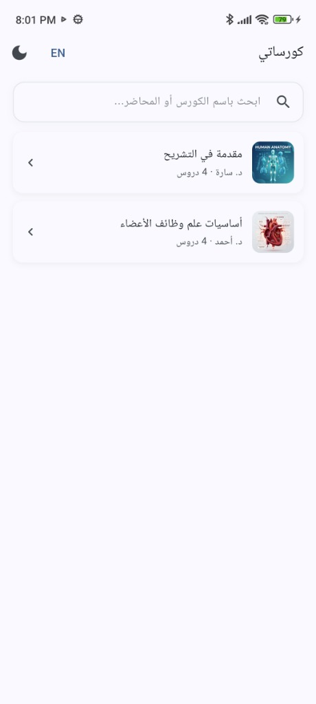
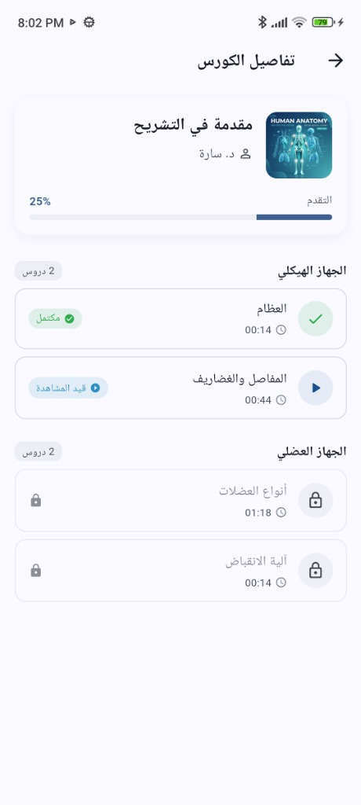
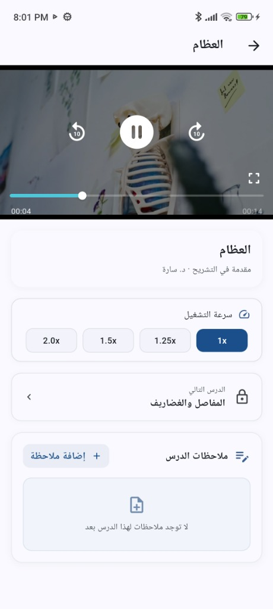
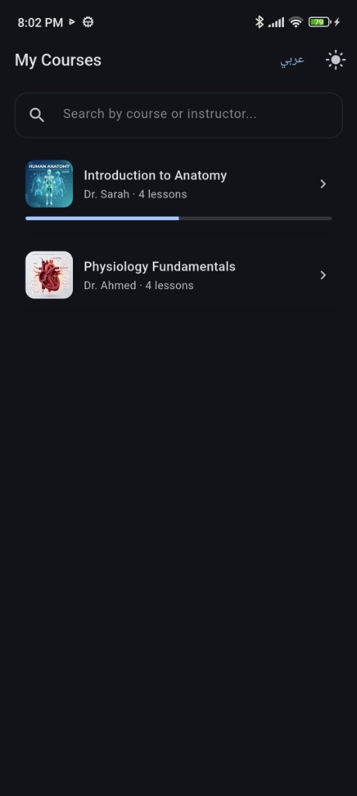

# Thaheen — Mini Offline LMS

> **Flutter Mobile Screening Task** · Arabic-first · 100% Offline · No backend

An offline, Arabic-first mobile learning application built with Flutter and BLoC (Cubit).
Health-sciences students can browse courses, track their learning progress, and watch recorded video lessons — with no network connection required.

---

## App Previews

| 1. Courses (Light / Arabic) | 2. Course Details (Progress & Lock) | 3. Video Player & Controls | 4. Dark Mode & English |
| :---: | :---: | :---: | :---: |
|  |  |  |  |
| *Bilingual search, RTL layout, progress bars* | *Sequential unlocking, status badges (Completed/In Progress/Locked)* | *Seek ±10s, speed options, lock-aware Next Lesson, Notes* | *Theme toggle (Dark Mode) & Instant English switch* |

---

## 1. How to Run

### Prerequisites
- **Flutter SDK** `≥ 3.10.8` — check with `flutter --version`
- Android or iOS device / emulator

### Steps

```bash
# 1. Clone
git clone https://github.com/farouk662/thaheen-mobile-lms.git
cd thaheen-mobile-lms

# 2. Install dependencies  (no build_runner / codegen step needed)
flutter pub get

# 3. Run
flutter run

# 4. Test
flutter test
```

> **No codegen required.** Hive is used without `@HiveType` annotations — data is stored as plain `Map<String, dynamic>`, so `build_runner` is entirely omitted.

Video assets (`assets/videos/lesson1.mp4`, `lesson2.mp4`, `lesson3.mp4`) are bundled directly in the repository.

---

## 2. Architecture & State Management

### Feature-First, No Domain Layer

```
lib/
├── core/
│   ├── constants/       # AppKeys — all Hive box, preference & record keys
│   ├── extensions/      # BuildContext extensions (colorScheme, theme)
│   ├── localization/    # AppStrings (JSON loader) & LocaleCubit
│   ├── routing/         # AppRouter — go_router config + route constants
│   ├── services/        # HiveService, ThemeCubit, GetIt DI setup
│   ├── theme/           # AppColors, AppTextStyles
│   └── widgets/
│       ├── adaptive/    # AppBackButton, AppForwardIcon
│       ├── buttons/     # AppButton
│       ├── cards/       # CourseCard, ContinueWatchingCard
│       ├── feedback/    # AppErrorView, AppEmptyView, AppLoadingView
│       └── fields/      # AppTextField
│
├── features/
│   ├── shared/
│   │   ├── data/
│   │   │   ├── datasources/   # CoursesLocalDataSource, ProgressLocalDataSource, NotesLocalDataSource
│   │   │   ├── models/        # Course, CourseSection, Lesson, LessonNote + UI DTOs
│   │   │   └── repositories/  # CourseRepository
│   │   └── logic/             # progress_rules.dart (pure Dart, zero Flutter imports)
│   │                          # app_exception.dart
│   │
│   ├── courses/               # CoursesView, CoursesCubit, course cards & search
│   ├── course_details/        # CourseDetailsView, CourseDetailsCubit, lesson tiles
│   └── player/                # PlayerView, PlayerCubit, video controls, speed menu, notes
│
test/
└── features/
    ├── shared/logic/          # progress_rules_test.dart    (17 unit tests)
    ├── course_details/
    │   └── presentation/widgets/  # lesson_tile_test.dart  (3 widget tests)
    └── player/
        └── presentation/widgets/  # next_lesson_button_test.dart (3 widget tests)
```

### Data Flow

```
JSON asset ──► CoursesLocalDataSource
                     │
Hive box ───► ProgressLocalDataSource ──► CourseRepository ──► Cubit ──► View
              NotesLocalDataSource               │
                                         (merges catalog +
                                          progress + rules)
```

1. **`CoursesLocalDataSource`** — reads `assets/data/courses.json` once, caches in memory.
2. **`ProgressLocalDataSource`** — synchronous Hive reads/writes for position, completion, speed.
3. **`CourseRepository`** — merges both sources, runs `progress_rules.dart`, returns immutable DTOs:
   - `CoursesData` — all courses + completed IDs + continue-watching item
   - `CourseDetailsData` — course with resolved lesson statuses + progress %
   - `LessonPlayerData` — current lesson, next lesson, unlock state, saved position, speed
4. **Cubits** — call repository, emit a sealed state hierarchy (`Initial / Loading / Loaded / Empty / Error`).
5. **Views** — `BlocBuilder` + exhaustive `switch (state)` — no `is`-checks.

### Key Decisions

| Decision | Rationale |
|---|---|
| **Cubit over Riverpod** | Deterministic unidirectional flow, zero event boilerplate, easy to test |
| **Hive over sqflite** | Pure-Dart, zero native dependency, fast synchronous reads for a single-box schema |
| **No `dartz` / `Either`** | No network layer → plain `AppException` thrown by repo, caught by Cubit; no `Failure` wrapping needed |
| **No `flutter_screenutil`** | 3-screen app doesn't need scaling infrastructure; plain `EdgeInsets` + `SizedBox` + `MediaQuery` suffice |
| **Custom `AppStrings`** | Avoids heavy localization packages; synchronous type-safe getters loaded from `ar.json`/`en.json` at startup |
| **`get_it` singletons / factories** | Data sources & repo → `LazySingleton`; Cubits → `Factory` (fresh instance per push, disposed on pop) |

---

## 3. Features

### Core Requirements
- [x] **Courses Screen** — thumbnails, title, instructor, lesson count, progress %, "Continue Watching" card
- [x] **Course Details Screen** — sections + lessons with status badges (*Not Started / In Progress / Completed*), sequential unlocking, friendly Arabic snackbar on locked-lesson tap
- [x] **Video Player Screen** — custom Chewie/video_player player: play/pause, ±10 s seek, elapsed/remaining time, seek bar, speed menu (1×, 1.25×, 1.5×, 2×), landscape/fullscreen toggle, resume from saved position, auto-complete at 90 %, unlock-aware "Next Lesson" button
- [x] **Local Persistence** — Hive: position saved every 2 s during playback + on `AppLifecycleState.paused/detached`; completion flag written once and trusted permanently
- [x] **Arabic-first & RTL** — full RTL layouts, platform-adaptive `AppBackButton` (Material arrow / Cupertino chevron), universal LTR media controls
- [x] **Error & Empty States** — `AppErrorView` with retry, `AppEmptyView`, `AppLoadingView`; inline video error via Chewie's `errorBuilder`

### Bonus Features
- [x] **Dark Mode** — persisted `ThemeCubit` (light / dark), toggle on the courses app bar
- [x] **Arabic / English Switch** — runtime locale toggle via `LocaleCubit`, persisted to Hive
- [x] **Remembered Playback Speed** — preferred speed persisted across sessions
- [x] **Bilingual Search** — instant real-time search filtering across Arabic and English titles/instructors
- [x] **Per-lesson Notes** — structured notes list saved in Hive, bottom-sheet creation, individual deletion

> 💡 **Quick Reviewer Guide to Test Bonus Features:**
> - 🌐 **Language Switch**: Tap the language button (`عربي` / `EN`) in the top AppBar to switch between Arabic (RTL) and English (LTR) instantly.
> - 🌙 **Dark Mode**: Tap the theme toggle icon (☀️ / 🌙) in the AppBar to toggle between Light and Dark themes.
> - 🔍 **Bilingual Search**: Use the search field at the top of the Courses screen to filter courses by either Arabic or English title/instructor.
> - ⚡ **Remembered Playback Speed**: Change the speed in the player (e.g. `1.5x`), navigate back, and open another lesson — the player restores your saved preference.
> - 📝 **Per-Lesson Notes**: Open any lesson, scroll beneath the player to the notes section, tap **"إضافة ملاحظة" / "Add Note"** to save notes into Hive, and swipe/tap delete to remove them.

---

## 4. Tests

**26 tests — all passing** (`flutter test`)

| File | Type | Count | What it covers |
|---|---|---|---|
| `progress_rules_test.dart` | Unit | 20 | `isLessonCompleted` (boundary at 90 %, division-by-zero), `isLessonUnlocked` (sequential + cross-section unlock), `courseProgressPercent` (empty, partial, full), `courseLessonCount`, `courseCompletionPercent`, `allLessons` ordering |
| `lesson_tile_test.dart` | Widget | 3 | Locked state (lock icon, no badge, `onLockedTap`), Completed state (checkmark, badge, `onTap`), In-Progress state (play icon, badge, `onTap`) |
| `next_lesson_button_test.dart` | Widget | 3 | Locked next lesson (`onLockedTap`), Unlocked next lesson (`onNextTap`), End-of-course (completion message, no nav icons) |

All widget tests: `TestWidgetsFlutterBinding.ensureInitialized()` + `AppStrings.init()` in `setUpAll`, wrapped in `MaterialApp` with `locale: Locale('ar')` + `Directionality.rtl`.

---

## 5. Hive Storage Schema

Single box: `AppKeys.progressBox` (`'progress'`)

| Key | Type | Description |
|---|---|---|
| `AppKeys.localeCode` | `String` | `'ar'` or `'en'` |
| `AppKeys.themeMode` | `String` | `'system'` / `'light'` / `'dark'` |
| `AppKeys.playbackSpeed` | `double` | e.g. `1.0`, `1.25`, `1.5`, `2.0` |
| `<lessonId>` | `Map` | `{ positionSec: int, completed: bool, lastWatchedAt: int }` |
| `'notes_list_<lessonId>'` | `List` | `[{ id, text, createdAtMs }]` |

**Completion integrity rule**: `completed: true` is the source of truth — once written, it is never removed. Position-based healing (`≥ 90 %` watch with `completed: false`) only *adds* to the completed set (catches force-kill scenarios); it never *removes* entries.

---

## 6. What I'd Do With More Time

1. **Repository unit tests with `mocktail`** — mock the Hive box and verify `CourseRepository` edge-case data transformations (corrupt progress, missing lesson IDs).
2. **Picture-in-Picture & background audio** — let medical students listen to lectures while referencing notes in other apps.
3. **Timestamp-anchored bookmarks** — tap a bookmark icon during playback to pin a note to a specific video timestamp, visible as markers on the seek bar.
4. **Video download & offline cache manager** — encrypted local caching for downloadable lessons with storage-quota management.
5. **End-of-section mini-quizzes** — quick comprehension checks after each section, results persisted locally.
6. **CI pipeline** — GitHub Actions running `flutter analyze` + `flutter test` on every PR.

---

## 7. Time Spent

**~5–6 hours** — planning, architecture, video player integration, RTL polish, error handling, bonus features (notes, search, theme, locale), bug fixes (completion persistence race condition, theme toggle double-tap), and documentation.
